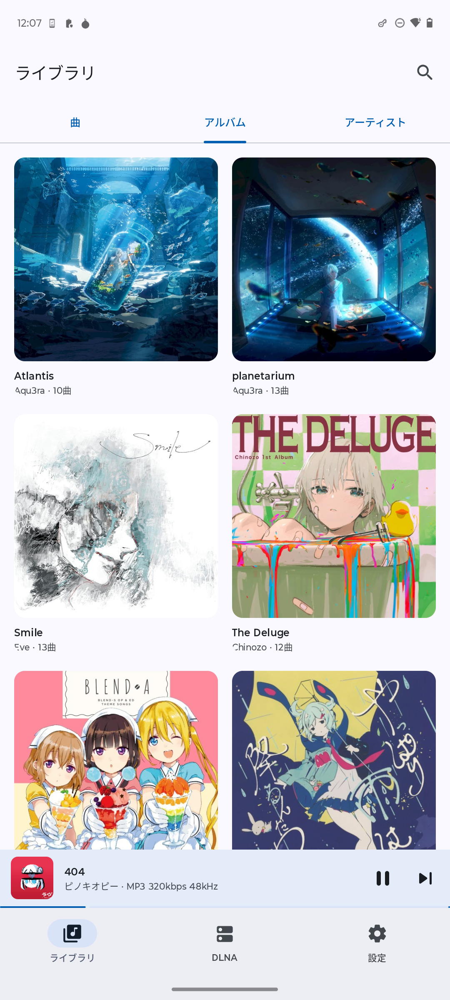
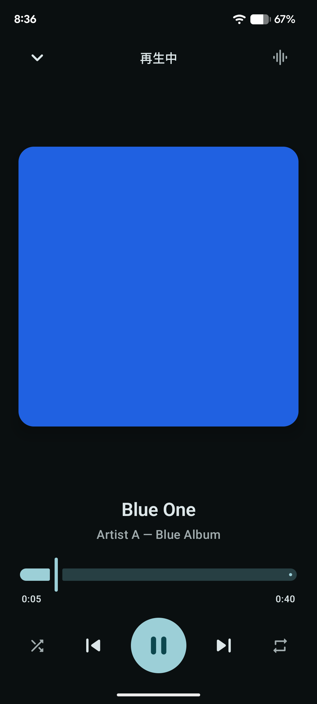
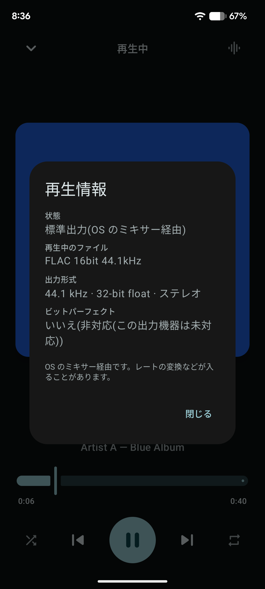
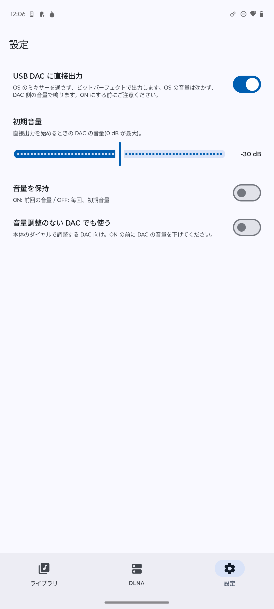

# RinPlay

[](LICENSE)

個人用の高音質音楽プレイヤー(Android)。ローカルファイルと DLNA サーバーの曲を再生でき、USB DAC には OS のミキサーを通さずに**直接出力(ビットパーフェクト)**できます。

<table>
  <tr>
    <th>ライブラリ</th>
    <th>再生中</th>
    <th>再生情報</th>
    <th>設定</th>
  </tr>
  <tr>
    <td></td>
    <td></td>
    <td></td>
    <td></td>
  </tr>
</table>

## 特長

- **ローカル再生**: 端末内の音楽(MediaStore)を、曲 / アルバム / アーティストで一覧。ジャケット表示、検索(全角/半角・大文字/小文字を区別しない)。
- **DLNA クライアント**: 自宅の DLNA サーバーを検出して、フォルダ・曲・アルバム・アーティストを閲覧して再生(jUPnP)。サーバー側の検索、大きなフォルダのページ送り、最後に開いた場所の記憶に対応。
  - **動作確認は MiniDLNA のみ**です。ほかのサーバーソフトでは、ライブラリを正しく読み込めない・検索できないなど、動作しない可能性があります(Universal Media Server では、ライブラリを正常に読み込めないことを確認しています)。
- **再生情報**: 再生中のファイルの形式(`FLAC 24bit 48kHz` など)と、音の出口(USB 直結 / OS のビットパーフェクト / 標準出力)を、再生画面のアイコンの状態で確認できます。タップで、出力形式を含む詳細を表示します。
- **USB DAC への直接出力**: OS のミキサーを通さず、元のサンプリングレートとビット列のまま DAC に送ります(設定で ON にしたときだけ)。詳しくは下記。

## USB DAC への直接出力

Android 標準の `setPreferredMixerAttributes` によるビットパーフェクト出力が使えない端末・DAC があるため、USB Audio Class 2.0 のアイソクロナス転送を自前で実装しています(Java の USB API は ISO 転送に非対応なので、ネイティブ(JNI)から `usbdevfs` を直接使います)。

### 使い方

1. DAC を端末に接続する。
2. 「設定」タブで「USB DAC に直接出力」を ON にする(**既定は OFF**)。
3. USB の権限ダイアログで許可する。
4. 再生する。再生画面の右上のアイコンが USB のマークになります。

### 注意

- **OS の音量が効きません。** DAC 側の音量で鳴ります。ON にする前に、DAC に付けたヘッドホンやイヤホンの音量にご注意ください。
- DAC 自身の音量(UAC2 の Feature Unit)を持つ機種は、アプリが「初期音量」(既定 −30 dB)まで下げてから出力し、閉じるときに元の音量へ戻します。再生画面の下部にスライダーが出ます。
- 本体のダイヤルで音量を調整する機種(音量を USB から操作できないもの)は、「音量調整のない DAC でも使う」を ON にしたときだけ使えます。この場合、アプリは音量を触りません。
- 直接出力している間は、OS の音(通知音など)がその DAC には出ません。
- 再生中に DAC を抜くと一時停止し、挿し直すと(権限を許可すれば)直結に戻ります。

### 動作確認した環境

| 端末 | DAC |
|---|---|
| Pixel 6a(Android 17) | Shanling UA3 / Fosi Audio ZH3 |
| Galaxy S26(SM-S942Q / Android 17) | Shanling UA3 / Fosi Audio ZH3 |

44.1 kHz / 48 kHz の再生で確認しています。音の聴感(ノイズ・音飛びなど)の確認は十分ではありません。

### 制限

- UAC2(USB Audio Class 2.0)のステレオ PCM のみ。DSD、フィードバックエンドポイントのない DAC は未対応です。
- 曲の切り替えでサンプリングレートが変わるときは、DAC を開き直すため、約 0.35 秒の無音が入ります(ギャップレスではありません)。
- 88.2 kHz 以上の再生、長時間の再生は、まだ確認していません。

## DLNA の対応状況

- 動作確認したサーバーは **MiniDLNA(1.3.3)のみ**です。
- **Universal Media Server** では、ライブラリを正常に読み込めませんでした(未対応)。
- そのほかのサーバーソフトも、フォルダ構成や検索機能の実装の違いで動作しない可能性があります。

## ダウンロード

[Releases](https://github.com/minittupoyo/rinplay/releases) から、署名つきの APK(`RinPlay-<バージョン>.apk`)をダウンロードしてインストールできます(Android 8.0 以上、arm64-v8a)。Releases の説明に、APK と署名証明書の SHA-256 を載せています。

> デバッグビルド(`./gradlew installDebug`)で入れたアプリとは署名が違うため、上書きインストールできません。先にアンインストールしてください(設定は引き継がれません)。

## 動作要件

- Android 8.0(API 26)以上、arm64-v8a
- 必要な権限: 音楽へのアクセス、通知、付近のデバイス(DLNA サーバーの検出。Android 17 では「ローカルネットワーク」)、USB デバイスへのアクセス(直接出力を使うとき)

## ビルド

- JDK 17 以上、Android SDK(compileSdk 37)
- NDK 28.2.13676358 と CMake 3.22.1(足りなければ Gradle が取得します)

```sh
./gradlew installDebug
```

## 構成

```
app/src/main/
├── java/net/minittu/rinplay/
│   ├── AppRoot.kt, *Screen.kt, MiniPlayer.kt   画面(Jetpack Compose / Material 3)
│   ├── PlaybackService.kt                      再生サービス(Media3)
│   ├── MusicRepository.kt                      ローカルのライブラリ(MediaStore)
│   ├── DlnaRepository.kt, dlna/                DLNA(jUPnP)
│   └── usb/                                    USB DAC への直接出力
└── cpp/usb_iso.cpp                             ISO 転送(usbdevfs)
```

実装の詳細、実機で分かったこと、既知の問題は、[CLAUDE.md](CLAUDE.md) にまとめています。

## 技術スタック

Kotlin / Jetpack Compose / Media3(ExoPlayer) / jUPnP / Coil 3 / NDK(C++)

## ライセンス

[MIT License](LICENSE)。依存ライブラリは、それぞれのライセンスに従います。
